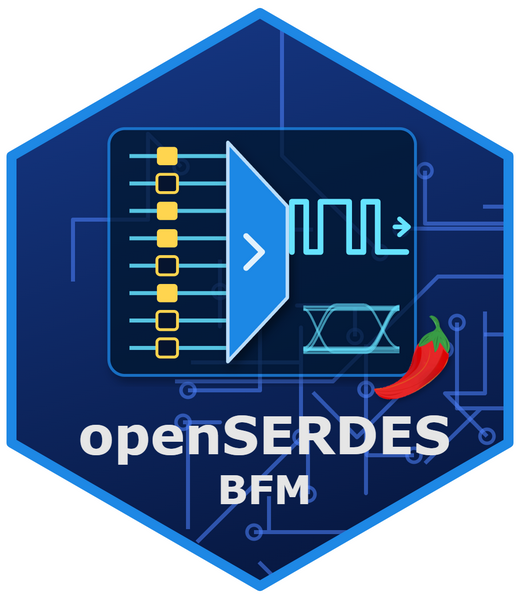
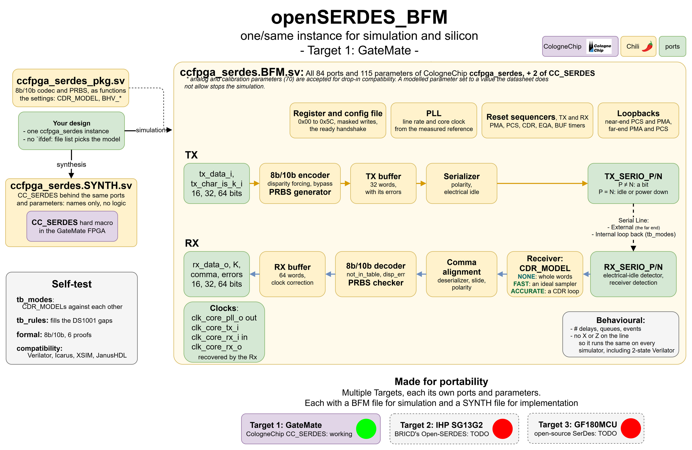
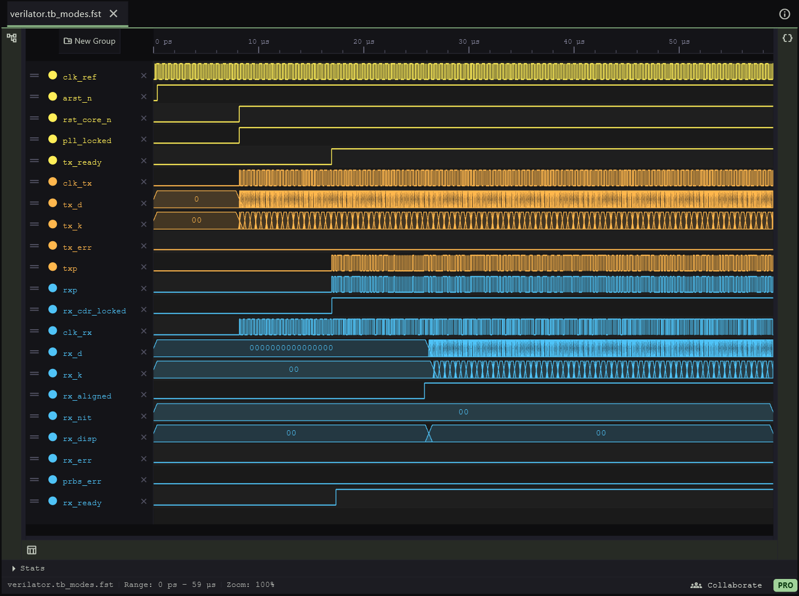
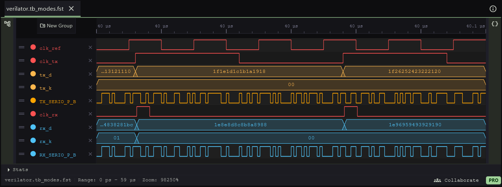
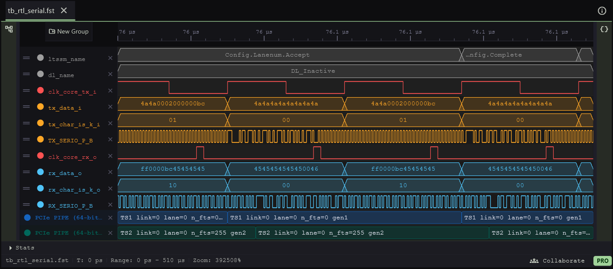
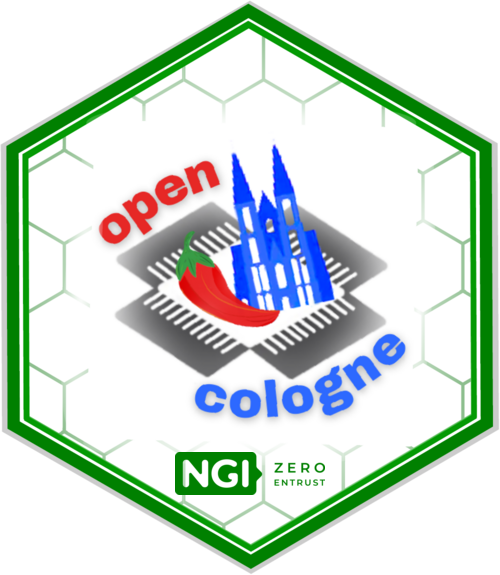
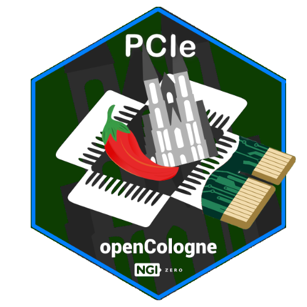
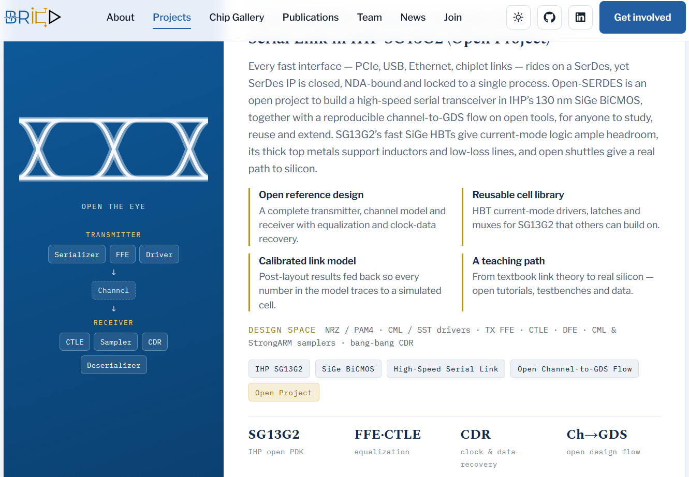
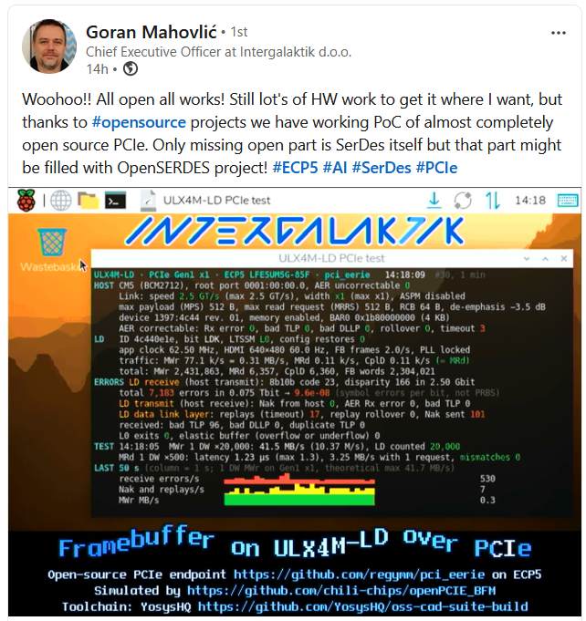

[](https://github.com/chili-chips/openSERDES_BFM/stargazers)
[](https://gitlab.com/chili-chips/openSERDES_BFM)
[](LICENSES)
[](REUSE.toml)
[](1.gatemate)
[](2.ihp-sg13g2)
[](3.gf180mcu)
[](#self-test)
[](#self-test)
[](#self-test)
[](#self-test)
[](1.gatemate/2.formal)
[](https://wavecrux.app)
[](https://github.com/chipsalliance/verible)

# openSERDES_BFM

<div align="center">
  
</div>

Open-source simulation models (bus functional models, BFMs) of SerDes hard macros and IP. One Target per SerDes. Each BFM has the SerDes's ports and parameters, so a design simulates as built, with open tools, and builds for silicon from the same instance.

### Made for portability

| Target | SerDes | Process / vendor | Status |
|-----|---|---|---|
| [1.gatemate](1.gatemate/README.md) | GateMate `CC_SERDES` hard macro, at its `ccfpga_serdes` wrapper level | [CologneChip](https://colognechip.com) GateMate FPGA | 🟢 working: Verilator, Icarus, XSIM, JanusHDL and the 8b/10b proofs pass ([self-test](#self-test)) |
| [2.ihp-sg13g2](2.ihp-sg13g2/README.md) | [BRICD](https://www.thebricd.org)'s Open-SERDES | 130 nm SiGe BiCMOS, [IHP](https://www.ihp-microelectronics.com) [SG13G2](https://github.com/IHP-GmbH/IHP-Open-PDK) | 🔴 TODO: the BFM follows the silicon design |
| [3.gf180mcu](3.gf180mcu/README.md) | open-source SerDes | 180 nm CMOS, GlobalFoundries [GF180MCU](https://github.com/google/gf180mcu-pdk) | 🔴 TODO: the BFM follows the silicon design |

### How is it made?!

<div align="center">
  
</div>

---
---
# Target 1: GateMate

<div align="center">
  <a href="https://colognechip.com"></a>
  &nbsp;&nbsp;
  <a href="https://colognechip.com/programmable-logic/gatemate/"></a>
</div>

A behavioural model of the SerDes of CologneChip's [GateMate FPGA](https://colognechip.com/programmable-logic/gatemate/), the `CC_SERDES` hard macro, made from CologneChip's datasheet DS1001 and their simulation model. It takes the module name, ports and parameters of their simulation model, `ccfpga_serdes`, so it drops in for it. `ccfpga_serdes.SYNTH.sv` puts `CC_SERDES` behind the same ports for the chip: the file list picks one.

Three levels of serial line and receiver (`CDR_MODEL`: `NONE`, `FAST`, `ACCURATE`), 8b/10b, PRBS, comma alignment, RX buffer with clock correction, reset sequencers, register file, PLL, electrical idle, receiver detection, loopback. Details, settings and where it differs from DS1001: [1.gatemate](1.gatemate/README.md).

### Self-test

```sh
cd 1.gatemate/3.sim-regression
make sim_modes    # Verilator: the CDR_MODELs against each other, PRBS, registers, then tb_rules
make sim_icarus   # Icarus: tb_modes and tb_rules, each CDR_MODEL
make sim_xsim     # Vivado XSIM: tb_modes at 64 bits, each CDR_MODEL, then tb_rules
make sim_janushdl # JanusHDL: as sim_xsim
make formal       # 8b/10b proofs: Yosys (read_slang) and Icarus
make              # sim_modes, sim_icarus, formal
make sanity       # the sanity list
make regression   # the regression list
make waves        # the waveforms for WaveCrux (below)
make lint         # Verible on the BFM and the test benches (lint.verible)
make clean        # removes work/
```

The Makefile has one target per simulator; there is no `SIM=` switch. Builds and logs go to `work/` (git-ignored).

- **Sanity** (`make sanity`, after every change): the proofs and a few runs on each simulator, about 2 minutes.
- **Regression** (`make regression`, before a push): every simulator target in full and the proofs, about 12 minutes.
- XSIM's `tb_rules` runs are listed as known failures (below): they do not fail a list, and pass it once the simulator is fixed.
- Sanity also runs JanusHDL `--race-detect` on `tb_rules`: a race not on the known list (`RACES_OK` in `run-sanity.sh`, empty now) fails it.

Results (WSL2 Ubuntu 24.04, wall clock with the build; 🟢 passes, 🟠 partly, 🔴 does not run):

| Simulator | `tb_modes` | `tb_rules` | Time |
|---|---|---|---|
| 🟢 Verilator 5.055 | PASS, 38 runs, 9 mode comparisons | PASS, 6 runs | 561 s for `make sim_modes` (16 builds); one run 0.04 s |
| 🟢 Icarus 14.0 (devel) | PASS, 15 runs | PASS, 6 runs | 33 s for `make sim_icarus` |
| 🟠 Vivado XSIM 2026.2 | PASS, 64 bits, each `CDR_MODEL` | no: the simulator kernel dies (`FATAL_ERROR`, a double free) with the testbench's line delay: [#9](https://github.com/chili-chips/openSERDES_BFM/issues/9) | about 4 s build, 4 s run, each |
| 🟢 JanusHDL 0.22.0 | PASS, 3 runs | PASS, 6 of 6 runs | 126 s for `make sim_janushdl` |
| 🟢 Yosys 0.70 + Icarus (`make formal`) | 8b/10b: 6 of 6 proved | | 19 s |

**Open upstream issues behind the results above:**

| Tool | Issue | What | State |
|---|---|---|---|
| Vivado XSIM | [AMD forum](https://adaptivesupport.amd.com/s/question/0D5Pd000026YeziKAC/xsim-20261-simulation-engine-not-responding-at-an-event-control-in-a-forked-process-of-a-behavioral-model), ours [#1](https://github.com/chili-chips/openSERDES_BFM/issues/1) | 2026.1: "Simulation engine not responding" at an event control in a forked process | open (worked around) |
| Vivado XSIM | [#9](https://github.com/chili-chips/openSERDES_BFM/issues/9) | 2026.1 and 2026.2: the kernel dies (`FATAL_ERROR`, a double free) in `tb_rules`, with its queue line delay | open |
| JanusHDL | [#8](https://github.com/chili-chips/openSERDES_BFM/issues/8) | 0.21.0 feature request: `--race-detect` to tell a harmless `always_comb` re-read from a glitch that reaches an edge | open |

### Waveforms

`make waves` runs `tb_modes` (64 bits, `ACCURATE`) and `tb_rules` (64 bits, `FAST`) once each, dumped whole, and writes `work/waves/verilator.tb_modes.fst`, `verilator.tb_rules.fst` and a [WaveCrux](https://wavecrux.app) session for each (`.wavecrux`, File > Open). `WAVES_SIM=icarus` does the same on Icarus. Rows: clocks, resets and PLL lock (yellow), TX data, K flags and line (orange), RX line, CDR lock, recovered clock, data and 8b/10b and alignment flags (blue).

<div align="center">
  
</div>

A whole bring-up in 59 µs: reset, PLL lock, TX ready, the line, CDR lock, comma alignment, then data with no 8b/10b, disparity or PRBS error.

<div align="center">
  
</div>

The same run at full traffic, 60 ns of it: 64-bit words of counting bytes (`tx_d`), every bit of them on the line (`TX_SERIO_P_B`, `RX_SERIO_P_B`), and the words recovered (`rx_d`).

<div align="center">
  
</div>

The BFM in [openCologne-PCIE](https://github.com/chili-chips/openCologne-PCIE)'s serial-link run, during link training: 64-bit words with COM (K28.5, `bc`) in byte 0 go out bit by bit, decoded as TS1 ordered sets by the [PCIE decoders](https://github.com/Ferrite-Engineering/wavecrux-decoders). The partner's TS2s come back deserialised, with COM in byte 4.

A session binds by signal number, which differs between simulators, so each FST gets its own (`wavecrux-session.py`). `tb_modes.wavecrux` and `tb_rules.wavecrux` next to the Makefile are for the Verilator dumps. Needs `fst2vcd` (GTKWave).

### How to use it in your project

Add it as a submodule, e.g. at `2.rtl/1.phy/openSERDES_BFM`:

```sh
git submodule add https://github.com/chili-chips/openSERDES_BFM.git 2.rtl/1.phy/openSERDES_BFM
```

Then point the file lists at the Target, package first:

- simulation: `1.gatemate/1.model/ccfpga_serdes_pkg.sv`, `1.gatemate/1.model/ccfpga_serdes.BFM.sv`
- synthesis: `1.gatemate/1.model/ccfpga_serdes.SYNTH.sv`
- Verilator: `1.gatemate/1.model/ccfpga_serdes.vlt` turns lint off for the model; `CDR_MODEL` is a define (`+define+CDR_MODEL=FAST`)
- timescale: none in the HDL; give `1ns/10ps` on the simulator command line. Verilator `--timescale 1ns/10ps`, XSIM `xelab --timescale 1ns/10ps`, Icarus a command file (`iverilog -c FILE`, the file holding `+timescale+1ns/10ps`); JanusHDL always uses 1ns/1ps

Used by [openCologne](https://github.com/chili-chips/openCologne) (`7.SerDes/1.openSERDES_BFM`) and [openCologne-PCIE](https://github.com/chili-chips/openCologne-PCIE) (`2.rtl/1.phy/2.openSERDES_BFM`), as a git submodule of both.

<div align="center">
  <a href="https://github.com/chili-chips/openCologne"></a>
  <a href="https://github.com/chili-chips/openCologne-PCIE"></a>
</div>

#### License

BSD-3-Clause (`REUSE.toml`, `LICENSES/`; `reuse lint` passes). The logos in `0.doc/artwork/`, except our own, belong to their owners and are shown for acknowledgment only (`LicenseRef-Third-Party-Document`).

CologneChip's datasheets (DS1001 and others) and their simulation model are not open-licensed and are not in this repository. Get them from [CologneChip](https://colognechip.com/programmable-logic/gatemate/).

#### Credits and Acknowledgments

The `CC_SERDES` hard macro of the GateMate FPGA, its datasheet DS1001 and the `ccfpga_serdes` simulation model it follows are [CologneChip](https://colognechip.com)'s. The BFM is by Chili.CHIPS; it is not a CologneChip product.

The BFMs are by Chili.CHIPS; this repository is volunteer work. Target 1 was developed and proven in the test jigs of two of our projects, both sponsored by [NLnet](https://nlnet.nl):

- [openCologne](https://github.com/chili-chips/openCologne): developed in `7.SerDes`, its IC Link PHY tests and test jigs.
- [openCologne-PCIE](https://github.com/chili-chips/openCologne-PCIE): behind its PHY, under the PIPE, MAC and DLL, to the full PCIE Endpoint on the serial line.

#### References

- [CologneChip](https://colognechip.com): the [GateMate FPGA](https://colognechip.com/programmable-logic/gatemate/), its datasheet DS1001 (the SerDes, section 2.5) and user guide UG1001
- [openCologne](https://github.com/chili-chips/openCologne) and [openCologne-PCIE](https://github.com/chili-chips/openCologne-PCIE): the projects Target 1 came from
- [ngscopeclient](https://www.ngscopeclient.org): open-source signal analysis for oscilloscopes and logic analyzers, with protocol decoders


---
---
# Target 2: ihp-sg13g2

<div align="center">
  <a href="https://www.thebricd.org"></a>
</div>

TODO

#### References

- [BRICD](https://www.thebricd.org)'s Open-SERDES
- [OpenSERDES](https://github.com/SparcLab/OpenSERDES), Purdue SPARC Lab: an all-digital, process-portable SerDes in SKY130; paper "OpenSerDes: An Open Source Process-Portable All-Digital Serial Link", DATE 2021 ([PDF](https://sparclab.github.io/Sparclab-website/static/pdfs/c/DATE_KGK_OpenSerdes.pdf), [IEEE](https://ieeexplore.ieee.org/document/9474250))
- 130nm SiGe BiCMOS [SG13G2](https://github.com/IHP-GmbH/IHP-Open-PDK)
- [IHP](https://www.ihp-microelectronics.com)

---
---
# Target 3: gf180mcu

TODO

#### References

- GlobalFoundries [GF180MCU PDK](https://github.com/google/gf180mcu-pdk)
- [wafer.space](https://wafer.space)


---
---
# Community Outreach

**Issues filed upstream** from this project, open and closed. Details of the open ones: [Self-test](#self-test). The issues from the 7.SerDes work this BFM came from: [openCologne 7.SerDes](https://github.com/chili-chips/openCologne/blob/main/7.SerDes/README.md#community-outreach).

| Tool / project | Issue | What | State |
|---|---|---|---|
| Vivado XSIM | [AMD forum](https://adaptivesupport.amd.com/s/question/0D5Pd000026YeziKAC/xsim-20261-simulation-engine-not-responding-at-an-event-control-in-a-forked-process-of-a-behavioral-model), ours [#1](https://github.com/chili-chips/openSERDES_BFM/issues/1) | 2026.1: "Simulation engine not responding" at an event control in a forked process of the TX reset sequence | open (worked around) |
| Vivado XSIM | [#9](https://github.com/chili-chips/openSERDES_BFM/issues/9) | 2026.1 and 2026.2: the kernel dies (`FATAL_ERROR`, a double free) in `tb_rules`, with its queue line delay | open |
| JanusHDL | [openCologne#12](https://github.com/chili-chips/openCologne/issues/12) | 0.17.0: an element of a queue of `realtime` is read as a bit-select (`tb_modes.sv:294`) | closed (fixed in 0.21.0) |
| JanusHDL | [openCologne#13](https://github.com/chili-chips/openCologne/issues/13) | 0.17.0: a run-time write to an element of a packed struct member (`ccfpga_serdes.BFM.sv:440`) | closed (fixed in 0.21.0) |
| JanusHDL | [#7](https://github.com/chili-chips/openSERDES_BFM/issues/7) | 0.21.0: a size cast of an instance parameter, `W'(inst.P)`, at run time (`tb_modes.sv:361`) | closed (fixed in 0.22.0) |
| JanusHDL | [#8](https://github.com/chili-chips/openSERDES_BFM/issues/8) | 0.21.0 feature request: `--race-detect` to tell a harmless `always_comb` re-read from a glitch that reaches an edge | open |
| Icarus Verilog | [iverilog#1877](https://github.com/steveicarus/iverilog/issues/1877) | 14.0 (devel) feature request: a queue of a packed struct; worked around with `bit [81:0]` ([#10](https://github.com/chili-chips/openSERDES_BFM/issues/10)) | open |
| Icarus Verilog | [iverilog#1882](https://github.com/steveicarus/iverilog/issues/1882) | feature request: race detection and a process-order portability check ([#11](https://github.com/chili-chips/openSERDES_BFM/issues/11)) | open |
| Verilator | [verilator#9326](https://github.com/verilator/verilator/issues/9326) | feature request: race detection and a process-order portability check ([#11](https://github.com/chili-chips/openSERDES_BFM/issues/11)) | open |
| Verilator | [verilator#9265](https://github.com/verilator/verilator/issues/9265) (our [comment](https://github.com/verilator/verilator/issues/9265#issuecomment-7083237425)) | 5.055: `always @(x)` with `fork ... join_none` does not converge; our case: the fork only reads `x` | open |

JanusHDL has no public tracker (closed source, so it can read encrypted IP): its issues are in our repos, under the [`JanusHDL` label](https://github.com/issues?q=org%3Achili-chips+label%3AJanusHDL).

A sampler of relevant posts:

- [End2End sim of PCIE link between Lattice and GateMate](https://lnkd.in/p/gpXvyHxD) (LinkedIn)

<div align="center">
  
</div>


---
---
# Opensource Tooling

All SerDes models are **`purposely designed to run on open-source and/or free simulators`**. The project is grateful to their developers, maintainers and wider community that keeps using and improving them. One of our objectives is also to provide first-hand feedback on these verification staples, as well as a robust test and regression jig for them. Towards that goal, we also validate with Vivado XSIM, which serves as baseline / reference point.

<div align="center">
  <a href="https://www.veripool.org/verilator"></a>
  <a href="https://github.com/steveicarus/iverilog"></a>
  <a href="https://que.no/janushdl"></a>
</div>

<div align="center">
  <a href="https://wavecrux.app"></a>
  <a href="https://github.com/chipsalliance/verible"></a>
</div>

- **Simulators and Linters**: [Verilator](https://www.veripool.org/verilator), [Icarus Verilog](https://github.com/steveicarus/iverilog), [JanusHDL](https://que.no/janushdl/), Vivado XSIM
- **Formal**: [Yosys](https://github.com/YosysHQ/yosys)
  - SystemVerilog front-end: [yosys-slang](https://github.com/povik/yosys-slang)
- **Waveforms, Protocol Decoders, Checkers**: [WaveCrux](https://wavecrux.app)
- **Neat Formatting, Lint**: [Verible](https://github.com/chipsalliance/verible), `make lint` in `1.gatemate/3.sim-regression`

---
## GenAI

Our repo may contain elements of work facilitated by modern GenAI tools , used under the guidance and supervision of the blood-and-flesh developers.

In the end, it is us, the human devs, who are fully responsible for any shortfalls you may uncover while tapping into repo resources.

--------------------
#### End of Document
