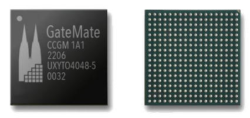
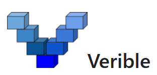

[](https://github.com/chili-chips/openSERDES_BFM/stargazers)
[](https://gitlab.com/chili-chips/openSERDES_BFM)
[](LICENSES)
[](REUSE.toml)
[](1.gatemate)
[](2.gf180mcu)
[](3.ihp-sg13g2)
[](#self-test)
[](#self-test)
[](#self-test)
[](https://que.no/janushdl/)
[](1.gatemate/2.formal)
[](https://wavecrux.app)
[](https://github.com/chipsalliance/verible)

# openSERDES_BFM

<div align="center">
  
</div>

Open-source simulation models (bus functional models, BFMs) of SerDes hard macros and IP. One Target per SerDes. Each BFM has the SerDes's ports and parameters, so a design simulates as built, with open tools, and builds for silicon from the same instance.

### Made for portability

| Target | SerDes | Process / vendor | Status |
|-----|---|---|---|
| [1.gatemate](1.gatemate/README.md) | GateMate `CC_SERDES` hard macro, at its `ccfpga_serdes` wrapper level | [Cologne Chip](https://colognechip.com) GateMate FPGA | 🟢 working: Verilator, Icarus, XSIM and the 8b/10b proofs pass; 🔴 JanusHDL ([self-test](#self-test)) |
| [2.gf180mcu](2.gf180mcu/README.md) | open-source SerDes | 180 nm CMOS, GlobalFoundries [GF180MCU](https://github.com/google/gf180mcu-pdk) | 🔴 TODO: the BFM follows the silicon design |
| [3.ihp-sg13g2](3.ihp-sg13g2/README.md) | [BRICD](https://www.thebricd.org)'s Open-SERDES | 130 nm SiGe BiCMOS, [IHP](https://www.ihp-microelectronics.com) [SG13G2](https://github.com/IHP-GmbH/IHP-Open-PDK) | 🔴 TODO: the BFM follows the silicon design |

---
---
# Target 1: GateMate

<div align="center">
  <a href="https://colognechip.com"></a>
  &nbsp;&nbsp;
  <a href="https://colognechip.com/programmable-logic/gatemate/"></a>
</div>

A behavioural model of the SerDes of Cologne Chip's [GateMate FPGA](https://colognechip.com/programmable-logic/gatemate/), the `CC_SERDES` hard macro, made from Cologne Chip's datasheet DS1001 and their simulation model. It takes the module name, ports and parameters of their simulation model, `ccfpga_serdes`, so it drops in for it. `ccfpga_serdes.SYNTH.sv` puts `CC_SERDES` behind the same ports for the chip: the file list picks one.

Three levels of serial line and receiver (`CDR_MODEL`: `NONE`, `FAST`, `ACCURATE`), 8b/10b, PRBS, comma alignment, RX buffer with clock correction, reset sequencers, register file, PLL, electrical idle, receiver detection, loopback. Details, settings and where it differs from DS1001: [1.gatemate](1.gatemate/README.md).

### Self-test

```sh
cd 1.gatemate/3.sim-regression
make sim_modes    # Verilator: the CDR_MODELs against each other, PRBS, registers, then tb_rules
make sim_icarus   # Icarus: tb_modes and tb_rules, each CDR_MODEL
make sim_xsim     # Vivado XSIM: tb_modes at 64 bits, each CDR_MODEL, then tb_rules
make sim_janushdl # JanusHDL: as sim_xsim
make formal       # 8b/10b proofs: Yosys (read_slang) and Icarus
make              # sim_modes, sim_icarus, formal
make sanity       # the sanity list
make regression   # the regression list
make waves        # the waveforms for WaveCrux (below)
make lint         # Verible on the BFM and the test benches (lint.verible)
make clean        # removes work/
```

The Makefile has one target per simulator; there is no `SIM=` switch. Builds and logs go to `work/` (git-ignored).

- **Sanity** (`make sanity`, after every change): the proofs and a few runs on each simulator, about 1.5 minutes.
- **Regression** (`make regression`, before a push): every simulator target in full and the proofs, about 11 minutes.
- JanusHDL runs are listed as known failures (below): they do not fail a list, and pass it once JanusHDL is fixed.

Results (WSL2 Ubuntu 24.04, wall clock with the build; 🟢 passes, 🟠 partly, 🔴 does not run):

| Simulator | `tb_modes` | `tb_rules` | Time |
|---|---|---|---|
| 🟢 Verilator 5.055 | PASS, 38 runs, 9 mode comparisons | PASS, 6 runs | 561 s for `make sim_modes` (16 builds); one run 0.04 s |
| 🟢 Icarus 14.0 (devel) | PASS, 15 runs | PASS, 6 runs | 33 s for `make sim_icarus` |
| 🟢 Vivado XSIM 2026.1 | PASS, 64 bits, each `CDR_MODEL` | PASS, 6 of 6 runs; the BFM works around an XSIM engine crash ([AMD forum](https://adaptivesupport.amd.com/s/question/0D5Pd000026YeziKAC/xsim-20261-simulation-engine-not-responding-at-an-event-control-in-a-forked-process-of-a-behavioral-model)) | about 4 s build, 4 s run, each |
| 🔴 JanusHDL 0.17.0 | no: does not elaborate (`tb_modes.sv:294`, a bit-select of a `real` array) | no: stops at time 0 (`ccfpga_serdes.BFM.sv:438`, a select of a select as a target, not supported at run time yet) | |
| 🟢 Yosys 0.70 + Icarus (`make formal`) | 8b/10b: 6 of 6 proved | | 19 s |

### Waveforms

`make waves` runs `tb_modes` (64 bits, `ACCURATE`) and `tb_rules` (64 bits, `FAST`) once each, dumped whole, and writes `work/waves/verilator.tb_modes.fst`, `verilator.tb_rules.fst` and a [WaveCrux](https://wavecrux.app) session for each (`.wavecrux`, File > Open). `WAVES_SIM=icarus` does the same on Icarus. Rows: clocks, resets and PLL lock (yellow), TX data, K flags and line (orange), RX line, CDR lock, recovered clock, data and 8b/10b and alignment flags (blue).

A session binds by signal number, which differs between simulators, so each FST gets its own (`wavecrux-session.py`). `tb_modes.wavecrux` and `tb_rules.wavecrux` next to the Makefile are for the Verilator dumps. Needs `fst2vcd` (GTKWave).

### How to use it in your project

Add it as a submodule, e.g. at `2.rtl/1.phy/openSERDES_BFM`:

```sh
git submodule add https://github.com/chili-chips/openSERDES_BFM.git 2.rtl/1.phy/openSERDES_BFM
```

Then point the file lists at the Target, package first:

- simulation: `1.gatemate/1.model/ccfpga_serdes_pkg.sv`, `1.gatemate/1.model/ccfpga_serdes.BFM.sv`
- synthesis: `1.gatemate/1.model/ccfpga_serdes.SYNTH.sv`
- Verilator: `1.gatemate/1.model/ccfpga_serdes.vlt` turns lint off for the model; `CDR_MODEL` is a define (`+define+CDR_MODEL=FAST`)

Planned users: [openCologne](https://github.com/chili-chips/openCologne) `7.SerDes` and [openCologne-PCIE](https://github.com/chili-chips/openCologne-PCIE) `2.rtl/1.phy`. Both hold copies of Target 1 today.

#### License

BSD-3-Clause (`REUSE.toml`, `LICENSES/`; `reuse lint` passes). The logos in `0.doc/artwork/` belong to their owners and are shown for acknowledgment only (`LicenseRef-Third-Party-Document`).

Cologne Chip's datasheets (DS1001 and others) and their simulation model are not open-licensed and are not in this repository. Get them from [Cologne Chip](https://colognechip.com/programmable-logic/gatemate/).

#### Credits and Acknowledgments

The `CC_SERDES` hard macro of the GateMate FPGA, its datasheet DS1001 and the `ccfpga_serdes` simulation model it follows are [Cologne Chip](https://colognechip.com)'s. The BFM is by Chili.CHIPS; it is not a Cologne Chip product.

The BFMs are by Chili.CHIPS; this repository is volunteer work. Target 1 was developed and proven in the test jigs of two of our projects, both sponsored by [NLnet](https://nlnet.nl):

- [openCologne](https://github.com/chili-chips/openCologne): developed in `7.SerDes`, its IC Link PHY tests and test jigs.
- [openCologne-PCIE](https://github.com/chili-chips/openCologne-PCIE): behind its PHY, under the PIPE, MAC and DLL, to the full PCIE Endpoint on the serial line.

#### References

- [Cologne Chip](https://colognechip.com): the [GateMate FPGA](https://colognechip.com/programmable-logic/gatemate/), its datasheet DS1001 (the SerDes, section 2.5) and user guide UG1001
- [openCologne](https://github.com/chili-chips/openCologne) and [openCologne-PCIE](https://github.com/chili-chips/openCologne-PCIE): the projects Target 1 came from


---
---
# Target 2: gf180mcu

TODO

#### References

- GlobalFoundries [GF180MCU PDK](https://github.com/google/gf180mcu-pdk)
- [wafer.space](https://wafer.space)
  
---
---
# Target 3: ihp-sg13g2

TODO

#### References

- [BRICD](https://www.thebricd.org)'s Open-SERDES
- 130nm SiGe BiCMOS [SG13G2](https://github.com/IHP-GmbH/IHP-Open-PDK)
- [IHP](https://www.ihp-microelectronics.com)


---
---
# Opensource Tooling

All SerDes models are **`purposely designed to run on open-source and/or free simulators`**. The project is grateful to their developers, maintainers and wider community that keeps using and improving them. One of our objectives is also to provide first-hand feedback on these verification staples, as well as a robust test and regression jig for them. Towards that goal, we also validate with Vivado XSIM, which serves as baseline / reference point.

<div align="center">
  <a href="https://www.veripool.org/verilator"></a>
  <a href="https://github.com/steveicarus/iverilog"></a>
  <a href="https://que.no/janushdl"></a>
</div>

<div align="center">
  <a href="https://wavecrux.app"></a>
  <a href="https://github.com/chipsalliance/verible"></a>
</div>

- **Simulators and Linters**: [Verilator](https://www.veripool.org/verilator), [Icarus Verilog](https://github.com/steveicarus/iverilog), [JanusHDL](https://que.no/janushdl/), Vivado XSIM
- **Formal**: [Yosys](https://github.com/YosysHQ/yosys)
  - SystemVerilog front-end: [yosys-slang](https://github.com/povik/yosys-slang)
- **Waveforms, Protocol Decoders, Checkers**: [WaveCrux](https://wavecrux.app)
- **Neat Formatting, Lint**: [Verible](https://github.com/chipsalliance/verible), `make lint` in `1.gatemate/3.sim-regression`

---
## GenAI

Our repo may contain elements of work facilitated by modern GenAI tools , used under the guidance and supervision of the blood-and-flesh developers.

In the end, it is us, the human devs, who are fully responsible for any shortfalls you may uncover while tapping into repo resources.

--------------------
#### End of Document
